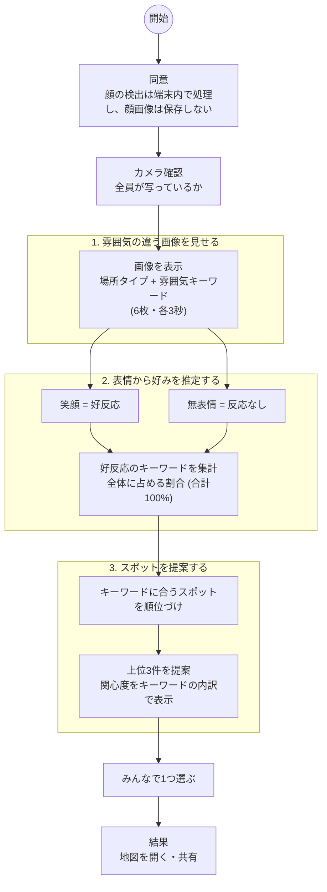
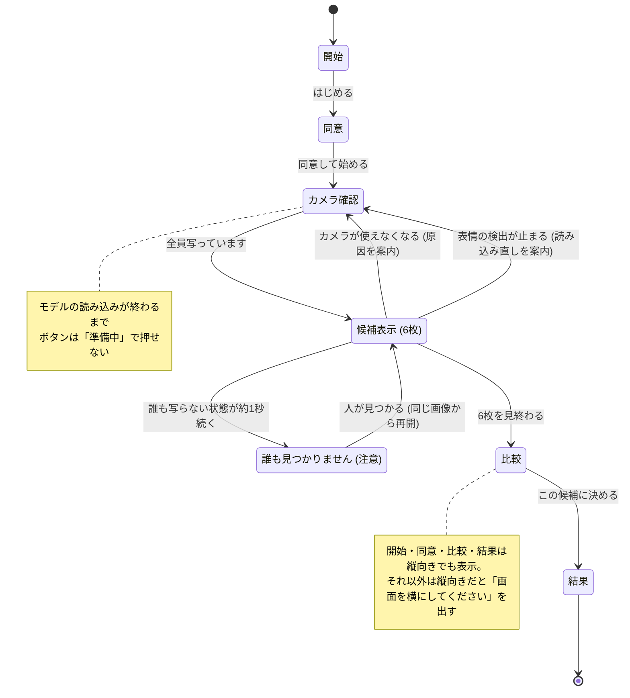
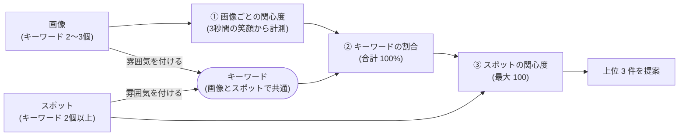

# NexTrip

1 台のスマホを囲んで、みんなの表情の反応を参考に、行き先をいっしょに決めるアプリです。

雰囲気の違う画像を順に見せ、表情(笑顔など)から「どんな雰囲気が好みか」を推定します。好反応だったキーワードの割合から、合いそうなスポットを提案します。

- 顔の検出はすべて端末内で行い、顔画像は保存しません。保存するのは計測した数値だけです。
- 表情からの推定は、あくまで参考値です。

> **開発状況:** 作成中です。この内容はこれから作ろうとしているものも含まれています。

## 全体像

### サービスの流れ



画像は、海・カフェ・山・自然・夜景・テーマパーク・温泉の 6 種類です。それぞれに場所タイプと雰囲気キーワード(のんびり、開放的、など)が付いています。

### 画面遷移



### 計算の流れ



1. **画像ごとの関心度(0〜100):** 画像を見ている 3 秒間の、笑顔だった時間の割合と、笑顔の強さを合成します。写っている全員の平均を使います。
2. **キーワードの割合:** 各キーワードの重みを「そのキーワードを持つ画像の関心度の合計」とし、全体に占める割合(合計 100%)にします。
3. **スポットの関心度:** そのスポットのキーワードの割合の合計(最大 100)です。高い順に上位 3 件を提案します。

### 写真の取得

写真の取得には、ウィキペディア(日本語版)の [MediaWiki Action API](https://www.mediawiki.org/wiki/API:Query) を使う予定です。返る画像の比率はまちまちなので、比較カードでは 4:3 の枠に `object-fit: cover` で表示します。取得サイズは `piprop=thumbnail&pithumbsize=960` を想定しています。

候補画面の雰囲気画像は自前で用意し、2:1(2000×1000 の WebP、1 枚 300KB 以下)にそろえます。スマホを横に置いたときの写真の枠に合わせた比率です。

## 始め方

必要なもの: Node.js、npm

```sh
npm install      # 顔検出の WASM を public/mediapipe/ にコピーする(postinstall)
npm run dev      # http://localhost:5173
```

| コマンド | 内容 |
|---|---|
| `npm run dev` | 開発サーバーを起動する |
| `npm run build` | 型チェックと本番ビルド |
| `npm run lint` | ESLint |
| `npm test` | 単体テスト(vitest) |

### カメラを使うときの注意

ブラウザのカメラ(`getUserMedia`)は、HTTPS または `localhost` でしか使えません。スマホの実機で試すときは、HTTPS で配信してください。

### 閾値の確認用ページ(開発用)

`/threshold.html` で、笑顔の閾値などを、カメラの映像を見ながら調整できます。本番ビルドには含まれません。

## 技術スタック

- React 19、TypeScript、Vite、CSS Modules
- 顔検出: [MediaPipe](https://ai.google.dev/edge/mediapipe) の `@mediapipe/tasks-vision`(FaceLandmarker のブレンドシェイプ)。モデルと WASM は自前で配信し、外部へは通信しません
- テスト: vitest

## ディレクトリ構成

依存の向きは `ui` / `infrastructure` → `application` → `domain` です。`domain` は React や外部ライブラリに依存しません。この向きは ESLint(`no-restricted-imports`)で確認していて、逆向きの import は `npm run lint` でエラーになります。

```
src/
  main.tsx      composition root(使う実装をここで選ぶ)
  domain/       ドメイン。React・ブラウザ・外部ライブラリに依存しない
    model.ts          型(画像・キーワード・スポット)
    ports.ts          データ取得の interface
    reaction/         表情の計測(笑顔の積算、関心度、画像ごとの計測)
    recommendation/   キーワードの割合の集計と、スポットの順位づけ
  application/  アプリケーションのルール。React に依存しない
    tripSession.ts    セッションの画面遷移と計測結果(reducer)
    ports.ts          表情の検出器の interface
    cameraGate.ts     表情判定に進めるか
    timing.ts         候補の表示時間
  infrastructure/   ports などの実装
    staticData.ts     画像・キーワード・スポットのダミーデータ
    mediapipe/        MediaPipe による顔検出
  ui/           React の画面
    App.tsx           セッションの状態に合わせた画面の出し分け
    screens/          画面と、画面ごとの向きの要否
    components/       画面で使う部品
    presenters/       画面に出す内容(文言・並び順)を、ドメインの結果から作る
    hooks/            セッションの状態、カメラの起動、向きの判定、表情の検出
  tools/        開発用ページ(閾値の確認)
public/mediapipe/   顔検出のモデルと WASM
```
